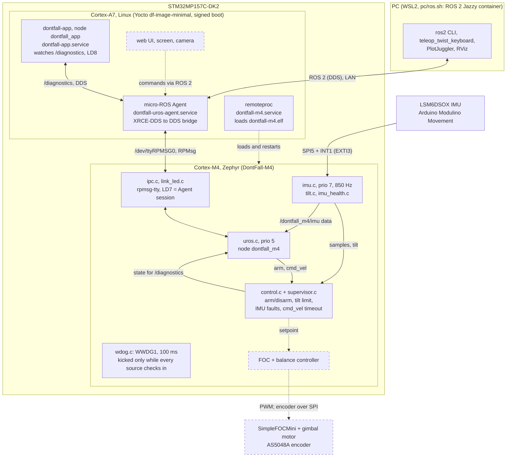

# DontFall architecture

What runs where and how the parts talk, as it is now. The why is in
`VISION.md`; pins and memory in `docs/hardware.md`. Keep this file current:
see "Keeping this up to date" at the end.

## The whole system

GitHub and VS Code render this. In a plain terminal, read the edges:
`A -->|label| B` means A sends to B over that link. Dashed boxes are
planned, not built yet (`docs/foc-plan.md`, `docs/balance-plan.md`).

## The ROS 2 interface of the M4

The node `dontfall_m4`, from `uros.c`. This is the only interface between
the A7 and the M4's control code.

| Name | Kind, type | QoS | Direction | Purpose |
|------|------------|-----|-----------|---------|
| `/dontfall_m4/imu` | publisher, `sensor_msgs/Imu` | best effort, 50 Hz | M4 -> A7 | IMU data and tilt estimate |
| `/diagnostics` | publisher, `diagnostic_msgs/DiagnosticArray` | reliable, 1 Hz | M4 -> A7 | IMU and supervisor state |
| `/dontfall_m4/arm` | service, `std_srvs/SetBool` | reliable | A7 -> M4 | arm (true) or disarm (false) |
| `/cmd_vel` | subscription, `geometry_msgs/Twist` | best effort | A7 -> M4 | speed setpoint, zeroed after a timeout |

## Who owns what

- **M4:** everything timing critical and every safety decision: the IMU,
  the supervisor (armed or not), the command timeout, the watchdog, and
  later the motors and balancing. It must stay safe with the A7 dead.
- **A7:** the micro-ROS Agent, the app (ROS 2 node `dontfall_app`), and later everything
  high level. It only sends commands; it never closes a fast loop.
- **Build host (`DontFall`):** Yocto layers in `meta-df`, the image, the
  M4 firmware built by bitbake from pinned revisions (`zephyr-m4`
  multiconfig), build and deploy scripts.

## Keeping this up to date

Update this file in the same change as any architectural change:

- a new or removed process, service, M4 thread or source module with its
  own job
- a new or changed link between parts (tty, RPMsg channel, bus, network)
- a micro-ROS entity added, removed, renamed or with another type or QoS
- a responsibility moving between the M4, the A7 and the PC
- a planned part becoming real (move it out of "Planned")

Bug fixes, tuning and changes inside a module don't need an update.
